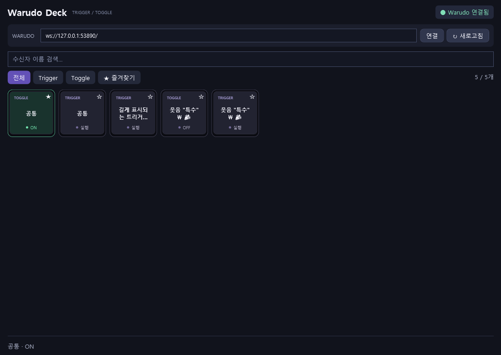

# Warudo Bridge

Warudo의 **On Stream Deck Trigger / On Stream Deck Toggle** 수신자를 자동으로 모아 클릭하는 Windows 앱입니다. 실제 스트림덱이나 별도 Warudo 플러그인은 필요하지 않습니다.

**[Windows x64 다운로드](https://github.com/moraecat/warudo-streamdeck-bridge/releases/latest/download/WarudoBridge-windows-x64.zip)** · **[릴리스 목록](https://github.com/moraecat/warudo-streamdeck-bridge/releases)**

ZIP을 전부 압축 해제한 뒤 `WarudoBridge.exe`를 실행하세요. .NET 런타임이 포함되어 있어 별도 설치가 필요하지 않습니다. Windows 10/11 x64용이며 macOS/Linux에서는 실행되지 않습니다.



## 실행

1. 배포 폴더의 `WarudoBridge.exe`를 실행합니다. 배포 폴더의 파일들은 함께 보관합니다.
2. Warudo에서 사용할 씬을 엽니다. `On Stream Deck Trigger` 또는 `On Stream Deck Toggle` 노드를 추가하고 **Receiver Name(수신자 이름)**을 지정합니다.
3. 기본 주소 `ws://localhost:19069/`로 자동 연결됩니다. 목록은 5초마다 갱신되며 **새로고침**으로 바로 조회할 수 있습니다.
4. 이름을 검색하거나 **Trigger / Toggle / 즐겨찾기**로 필터링한 뒤 정사각형 키를 누릅니다. 버튼 전체가 실행 영역이며 오른쪽 위 별표는 즐겨찾기 전용입니다. `Ctrl+F`는 검색창으로 이동합니다.

키는 104×104 크기로 창 너비에 맞춰 촘촘히 배치됩니다. 토글이 ON이면 테두리와 표시등이 초록색으로 바뀝니다. 긴 이름은 마우스를 올려 전체 내용을 확인할 수 있습니다.

같은 종류에서 수신자 이름이 같으면 **하나의 버튼으로 함께 실행**됩니다. Trigger와 Toggle은 이름이 같아도 별도 버튼입니다. 토글의 ON/OFF는 Warudo가 알려준 상태입니다. Trigger의 ‘전송됨’은 네트워크 전송 결과이며 연결된 블루프린트의 실행 완료를 뜻하지 않습니다.

## 연결 문제

- 스트림덱 노드가 만들어져야 Warudo가 해당 서버를 엽니다. Warudo가 켜져 있어도 노드가 없는 씬에서는 연결되지 않을 수 있습니다.
- 먼저 Warudo 실행, 씬의 노드, 수신자 이름을 확인하세요. 필요하면 `ws://127.0.0.1:19069/`도 확인할 수 있습니다.
- 연결이 끊기면 버튼이 비활성화되고 자동 재연결합니다. 이전 클릭은 저장하거나 다시 전송하지 않습니다.
- 토글 확인이 늦으면 연결을 새로 맺어 현재 상태를 다시 조회합니다. 이미 보낸 토글을 자동 재전송하지 않습니다.
- 설정은 `%LOCALAPPDATA%/WarudoBridge/settings.json`에 저장됩니다. 손상된 설정은 `.corrupt-...` 파일로 보관합니다.
- 이 앱은 수신자를 노드 ID가 아닌 정확한 이름으로 지정합니다. 실행 결과가 없다면 Warudo의 노드 연결과 블루프린트 상태를 확인하세요.

## 빌드와 테스트

.NET 8 SDK와 RTK가 필요합니다. Unity 빌드는 필요하지 않습니다. 이 폴더에서:

```powershell
rtk powershell -NoProfile -ExecutionPolicy Bypass -File ./Build.ps1
```

기본 빌드는 런타임을 포함한 Windows x64 배포본을 생성합니다. NuGet 접근이 필요하며, 외부 패키지는 사용하지 않습니다. 다운로드가 불가능한 환경에서는 다음 명령으로 설치된 **.NET 8 Desktop Runtime x64**를 사용하는 배포본을 생성할 수 있습니다.

```powershell
rtk powershell -NoProfile -ExecutionPolicy Bypass -File ./Build.ps1 -FrameworkDependent
```

기존 실행 파일을 사용 중이면 `-OutputDirectory artifacts/win-x64-deck`처럼 별도 출력 폴더를 지정할 수 있습니다. 기존 앱을 종료한 뒤 새 폴더의 실행 파일을 열면 저장된 주소와 즐겨찾기를 그대로 사용합니다.

테스트는 실제 WebSocket 클라이언트를 로컬 모의 서버에 연결합니다. UI 테스트는 Windows WPF 화면을 메모리에서 구성하여 검색·필터·클릭·즐겨찾기·연결 종료를 확인하고 `artifacts/ui-preview.png`에 렌더링합니다. 사용자의 실제 Warudo 노드를 실행하지 않습니다.

```powershell
rtk dotnet build Bridge.Tests -m:1
rtk dotnet Bridge.Tests/bin/Debug/net8.0/Bridge.Tests.dll
rtk dotnet build Bridge.UiTests -m:1
rtk dotnet Bridge.UiTests/bin/Debug/net8.0-windows/Bridge.UiTests.dll artifacts/ui-preview.png
```

## 통신과 소스 구성

- `Bridge.Core`: WebSocket, 수신자 모델, 설정 저장.
- `Bridge.App`: WPF 화면과 연결 수명 관리.
- `Bridge.Tests`: 프로토콜과 설정 회귀 테스트 및 모의 서버.
- `Bridge.UiTests`: 실제 WPF 화면을 사용하는 상호작용 검증.

Warudo의 로컬 디컴파일 소스에서 확인한 `getReceivers`, `getToggles`, `trigger`, `toggle` 규약을 사용합니다. 수신자 조회 응답에는 요청 ID나 종류가 없어 조회를 직렬화하고, 조회 또는 토글 확인 타임아웃 시 모호해진 연결을 교체합니다. 연결 주소는 신뢰하는 Warudo 서버로만 설정하세요.
